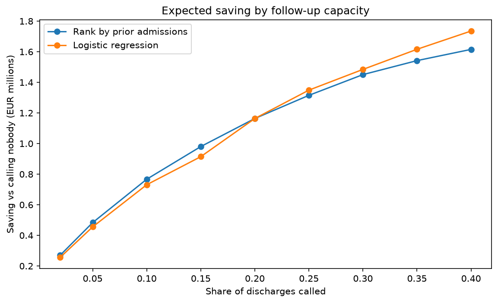

# hospital-readmission-targeting

# Who should the follow-up team call?

Targeting post-discharge follow-up calls under a capacity constraint,
using ten years of US hospital readmission data.

## The question

A post-discharge follow-up team can only call a fraction of patients
discharged each day. Which ones should they call?

Readmission risk rises steadily with prior inpatient admissions — from
8.6% for patients with none to over 30% for those with five — so a team
could simply rank by that column. The question is whether a model picks
a better slice than that, and whether the difference is worth anything.

## The data

[Diabetes 130-US Hospitals, 1999–2008](https://archive.ics.uci.edu/dataset/296/diabetes-130-us-hospitals-for-years-1999-2008)
— 101,766 inpatient encounters, 50 columns, CC BY 4.0. Real hospital
operational data with the outcome recorded, and messy in ways that require
judgement calls.

## Approach

- Removed 2,423 encounters discharged to hospice or recorded as deceased —
  they were never at risk of readmission, and including them as negatives
  teaches a model that the sickest patients are the safest.
- Split train/test by patient ID, not by row: 101,766 encounters belong to
  71,518 patients, so a row-level split leaks the same patient into both sides.
- Baseline: rank by prior inpatient admissions, call the top N. The rule an
  operations team could use today without any model.
- Logistic regression on 22 features, scaled, balanced class weights, scored
  on the held-out set once.
- Compared both at capacity levels from 2% to 40% under assumed intervention
  costs, then tested sensitivity to those assumptions.

## Findings

At 10% capacity — 1,976 calls on 19,765 discharges:

| Approach | Readmissions caught | Hit rate |
| Rank by prior admissions | 502 | 25.4% |
| Logistic regression | 484 | 24.5% |

Against an 11.6% base rate, the simple rule is 2.2× better than calling at
random. The model does not beat it.

The two cross at 20% capacity. Below it the rule wins; above it the model
pulls ahead, because most patients sit at zero or one prior admission and
the rule cannot separate them while the model can.

Assuming a call prevents 10% of the readmissions it catches, expected saving
peaks near €180k — at 15% capacity using the rule, 25% using the model. The
crossover holds under a 2.5× change in that assumption.

## Recommendation

Measure whether the calls work before investing in a model. Changing the
assumed prevention rate moves the optimal capacity and the expected saving
substantially; switching ranking method moves the result by under 4%.

Below 20% capacity, ranking by prior inpatient admissions performs as well
as the model, costs nothing to build and needs no maintenance.

## Notes on the data

`A1Cresult` and `max_glu_serum` use the literal value `None` to mean the test
was not performed. Pandas reads that as missing by default, which silently
removes the dataset's most-studied feature — and the fix has to be reapplied
on every read, including of the processed files. `weight` is 97% empty and was
dropped; missingness in `payer_code` was kept as its own category, since which
patients have no payer recorded is plausibly informative.

## Limitations

Intervention costs (€8,000 per readmission, €120 per call) are assumed, not
derived from the data, though the conclusion holds across a range. There are
no usable timestamps, so no temporal validation. `>30` readmissions collapse
into the negative class, scoping the question to the 30-day window. No fairness
audit across race or age — the data carries both, and a targeting model that
under-calls one group is a real operational risk. That is the first thing I
would add.
